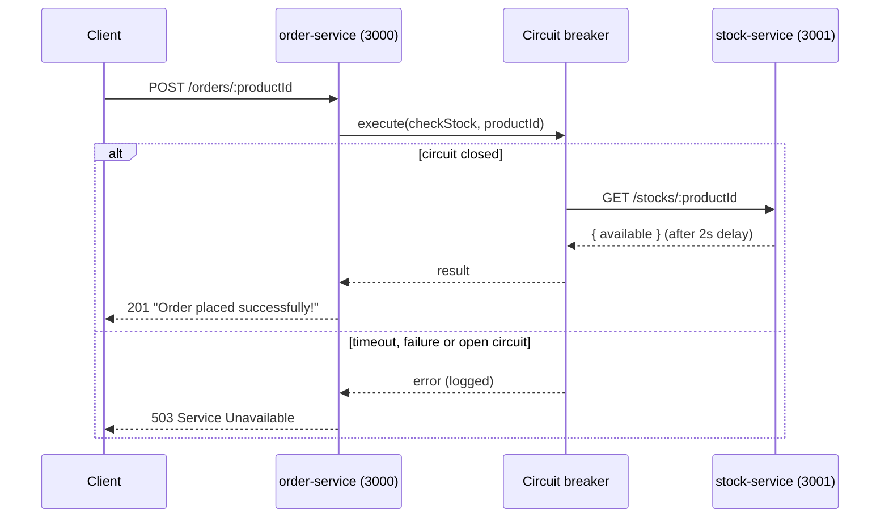

# NestJS Circuit Breaker

Two small NestJS services that show the circuit breaker pattern for service-to-service HTTP calls.
`order-service` asks `stock-service` whether a product is in stock before placing an order, and wraps that
call in a circuit breaker from the `easy-circuit-breaker` package.

## What this demonstrates

- An `order-service` that calls `stock-service` over HTTP with `axios`
- Wrapping the outbound call in `CircuitBreaker.execute()` at `CircuitBreakerLevel.Endpoint`, named `checkStock`
- Logging hooks for the breaker's `timeout`, `failure` and `reject` events
- An optional fallback (`checkStockFallbackFunction`, returns `{ available: true }`), wired but commented out
- A slow downstream: `stock-service` waits 2 seconds before every response, so timeouts and failures are easy to trigger
- Mapping any breaker error to `503 Service Unavailable`

## Tech stack

- Node.js, TypeScript, NestJS 10 (Express platform)
- `axios` for HTTP calls
- `easy-circuit-breaker` for the breaker (`opossum` is also installed in `order-service` but not used in the code)
- Jest for tests (Nest default setup)

## Architecture



Note: the out-of-stock `400` is thrown inside the same `try` block, so it is also caught and returned as `503`.

## Getting started

Prerequisites: Node.js and npm.

Install and start each service in its own terminal:

```bash
cd stock-service
npm install
npm run start:dev    # listens on 3001
```

```bash
cd order-service
npm install
npm run start:dev    # listens on 3000
```

Try it:

```bash
curl -X POST http://localhost:3000/orders/1   # in stock
curl -X POST http://localhost:3000/orders/2   # stock is 0
```

Stop `stock-service` and call the order endpoint again to watch the breaker log failures and reject calls.

Other scripts (both services): `npm run build`, `npm run start:prod`, `npm run lint`, `npm test`, `npm run test:e2e`.

## Environment variables

| Name | Meaning |
|------|---------|
| `PORT` | HTTP port. Defaults to `3000` for `order-service` and `3001` for `stock-service` |

The stock service URL is hardcoded in `order-service/src/order/order.service.ts` as `http://localhost:3001/stocks`.

## API endpoints

### order-service (port 3000)

| Method | Path | Purpose |
|--------|------|---------|
| GET | `/` | Hello World |
| POST | `/orders/:productId` | Check stock through the circuit breaker and place an order |

### stock-service (port 3001)

| Method | Path | Purpose |
|--------|------|---------|
| GET | `/` | Hello World |
| GET | `/stocks/:productId` | Return `{ available }` for a product after a 2s delay |

Sample stock data (in memory): product `1` has 5 units, product `2` has 0, product `3` has 10.
Unknown products return `{ message: "Product not found", available: false }`.

## Project structure

```
.
├── order-service/
│   └── src/
│       ├── main.ts
│       ├── app.module.ts
│       └── order/          # OrderController, OrderService (circuit breaker + axios)
└── stock-service/
    └── src/
        ├── main.ts
        ├── app.module.ts
        └── stock/          # StockController, StockService (in-memory stock, 2s delay)
```
